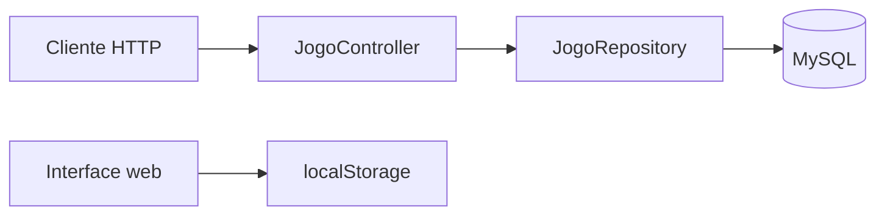

# Steam Library — API REST


## Sobre o projeto

Steam Library é um projeto acadêmico de gerenciamento de uma biblioteca digital de jogos, inspirado na interface da Steam.

A aplicação possui uma API REST desenvolvida com Java e Spring Boot para cadastro e consulta de jogos, utilizando Spring Data JPA e MySQL para persistência dos dados.

O projeto também conta com uma interface web responsiva desenvolvida com HTML, CSS e JavaScript, que permite gerenciar uma coleção de jogos diretamente no navegador.

## Funcionalidades

### Back-end

- Cadastro de jogos.
- Listagem de jogos cadastrados.
- Persistência de dados no MySQL.
- Geração automática de identificadores.
- Comunicação por HTTP e JSON.

### Front-end

- Cadastro, edição e exclusão de jogos.
- Pesquisa por nome ou desenvolvedora.
- Filtro por gênero.
- Ordenação por nome, preço ou ordem de cadastro.
- Exibição de capas e descrições.
- Indicadores de quantidade de jogos, jogos gratuitos e valor total do catálogo.
- Armazenamento local com `localStorage`.
- Interface responsiva inspirada na Steam.

**Nota:** atualmente, o front-end funciona de forma independente da API REST. Os dados cadastrados pela interface são armazenados no navegador, e os dados enviados à API são persistidos no banco de dados.

## Tecnologias utilizadas

| Tecnologia | Finalidade |
| --- | --- |
| Java 25 | Desenvolvimento do back-end |
| Spring Boot 4.2.0 | Configuração e execução da aplicação |
| Spring Web MVC | Implementação da API REST |
| Spring Data JPA | Acesso e persistência de dados |
| Hibernate | Mapeamento objeto-relacional |
| MySQL | Banco de dados da aplicação |
| H2 | Banco de dados em memória nos testes |
| Maven | Gerenciamento de dependências e build |
| JUnit 5 | Testes automatizados |
| HTML5, CSS3 e JavaScript | Desenvolvimento da interface web |

## Estrutura do projeto

```text
steam-api/
└── Steam/
    ├── src/
    │   ├── main/
    │   │   ├── java/com/dest1/steam/
    │   │   │   ├── controllers/
    │   │   │   │   └── JogoController.java
    │   │   │   ├── entities/
    │   │   │   │   └── Jogo.java
    │   │   │   ├── repositories/
    │   │   │   │   └── JogoRepository.java
    │   │   │   └── SteamApplication.java
    │   │   └── resources/
    │   │       ├── static/
    │   │       │   └── index.html
    │   │       ├── application.properties
    │   │       └── application-mysql.properties
    │   └── test/java/com/dest1/steam/
    │       ├── JogoControllerIntegrationTests.java
    │       └── SteamApplicationTests.java
    ├── pom.xml
    ├── mvnw
    └── mvnw.cmd
```

## Arquitetura

- **Controller:** recebe as requisições HTTP e retorna os dados da API.
- **Entity:** representa o modelo de jogo, mapeado para a tabela `tb_jogo`.
- **Repository:** utiliza `JpaRepository` para operações de persistência.



## Endpoints da API

URL base: `http://localhost:8080/api/jogos`

| Método | Endpoint | Descrição | Status de sucesso |
| --- | --- | --- | --- |
| GET | `/api/jogos` | Lista todos os jogos | 200 OK |
| POST | `/api/jogos` | Cadastra um jogo | 200 OK |

### Cadastrar um jogo

**POST** `/api/jogos`

Content-Type: `application/json`

Exemplo de corpo da requisição:

```json
{
  "nome": "Portal 2",
  "genero": "Puzzle",
  "criador": "Valve",
  "ano": 2011,
  "modo": "Individual e cooperativo",
  "classificacao": "10 anos",
  "descricao": "Jogo de quebra-cabeças com portais.",
  "capa": "",
  "disponivel": true
}
```

A API retorna o objeto persistido, incluindo o `id` gerado.

### Listar jogos

**GET** `/api/jogos`

```bash
curl http://localhost:8080/api/jogos
```

Exemplo de resposta:

```json
[
  {
    "id": 1,
    "nome": "Portal 2",
    "genero": "Puzzle",
    "criador": "Valve",
    "ano": 2011,
    "modo": "Individual e cooperativo",
    "classificacao": "10 anos",
    "descricao": "Jogo de quebra-cabeças com portais.",
    "capa": "",
    "disponivel": true
  }
]
```

## Como executar o projeto

### Pré-requisitos

- JDK 25.
- MySQL instalado e em execução.
- Git.
- Acesso às dependências Maven (o projeto inclui Maven Wrapper).

### 1. Clone o repositório

```bash
git clone https://github.com/LuisGustavoSNN/steam-api.git
cd steam-api/Steam
```

### 2. Configure o banco de dados

O projeto utiliza, por padrão, um banco MySQL chamado `roblox`, conforme a configuração existente no código.

Para utilizar o perfil `mysql`, configure as seguintes variáveis de ambiente de acordo com suas credenciais:

| Variável | Descrição | Valor padrão no perfil mysql |
| --- | --- | --- |
| `DB_URL` | URL JDBC | `jdbc:mysql://localhost:3306/roblox?createDatabaseIfNotExist=true` |
| `DB_USER` | Usuário do banco | `root` |
| `DB_PASSWORD` | Senha do banco | Vazia |

O Hibernate está configurado com `ddl-auto=update`, permitindo a atualização da estrutura das tabelas.

Não publique credenciais reais no repositório.

### 3. Execute a aplicação

Linux ou macOS:

```bash
./mvnw spring-boot:run -Dspring-boot.run.profiles=mysql
```

Windows (PowerShell):

```powershell
.\mvnw.cmd spring-boot:run "-Dspring-boot.run.profiles=mysql"
```

### 4. Acesse a aplicação

- Interface web: http://localhost:8080
- API REST: http://localhost:8080/api/jogos

## Testes automatizados

O projeto possui testes de inicialização do contexto Spring e testes de integração que verificam o cadastro e a listagem de jogos por requisições HTTP.

Os testes utilizam H2 em memória.

Linux ou macOS:

```bash
./mvnw test
```

Windows:

```powershell
.\mvnw.cmd test
```

## Melhorias futuras

- Integrar a interface web com a API REST.
- Implementar endpoints específicos para atualização e exclusão.
- Implementar consulta de jogos por ID.
- Adicionar validação de dados e tratamento de exceções.
- Padronizar o tipo do identificador entre a entidade e o repositório.
- Unificar os campos utilizados no front-end e no back-end.
- Adicionar documentação com OpenAPI e Swagger.

## Autor

Desenvolvido por **Luis Gustavo**.

[GitHub](https://github.com/LuisGustavoSNN)

---

Projeto acadêmico independente, inspirado na Steam, sem vínculo com a Valve.
